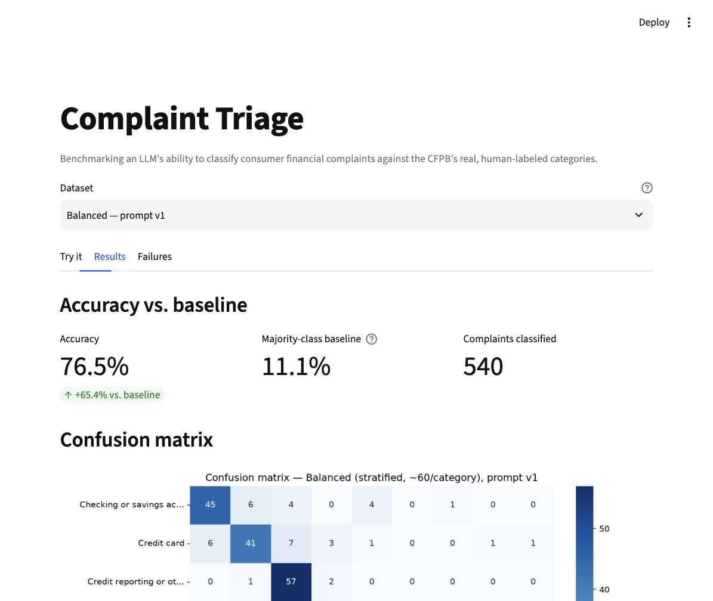

# Complaint Triage

A small benchmark that measures how accurately an LLM (Claude Haiku 4.5) can classify
real consumer financial complaints into the correct product category — using the
Consumer Financial Protection Bureau's (CFPB) public complaint database as ground truth.

## What this does, in plain terms

1. **Fetches real complaints** from the CFPB's public API — actual free-text
   descriptions consumers wrote when filing a complaint against a bank, lender,
   or credit reporting agency, plus the category ("product") a CFPB reviewer
   assigned to each one.
2. **Sends each complaint narrative to Claude** and asks it to guess the same
   category, rate how urgent the complaint sounds, and explain its reasoning.
3. **Scores the AI's guesses against the CFPB's real labels** and shows exactly
   where the model gets it right, where it gets confused, and why.

## Why CFPB data is a good benchmark

Most "test the AI" projects use made-up examples, which makes it easy to
accidentally write text the model can classify trivially. This project instead
uses a **real, independently-labeled dataset**:

- The labels weren't chosen by us or by the AI — they were assigned by CFPB
  staff (or the companies themselves) as part of an actual regulatory process,
  long before this project existed. That makes them a genuine, external
  ground truth.
- The complaint narratives are messy, real-world text: typos, redacted names
  (`XXXX`), rambling explanations, multiple issues mentioned in one complaint.
  That's a much more realistic test of classification ability than clean,
  synthetic examples.
- The categories are a **closed, fixed list** (see `src/taxonomy.py`), so
  "correct" and "incorrect" are unambiguous — the model either matches the
  official category or it doesn't.

## Project structure

```
complaint-triage/
├── data/                            # all gitignored — regenerated by the scripts below
│   ├── raw_complaints.json          # original random sample (~84% one category)
│   ├── balanced_complaints.json     # stratified sample, ~60 complaints/category
│   ├── results.csv                  # classified: raw dataset, prompt v1
│   ├── results_balanced.csv         # classified: balanced dataset, prompt v1
│   └── results_balanced_v2.csv      # classified: balanced dataset, prompt v2 (disambiguation)
├── charts/                          # confusion matrix + urgency chart per dataset (gitignored)
├── docs/
│   └── results_screenshot.jpg
├── src/
│   ├── fetch_data.py                # pull + cache CFPB complaints (random or stratified)
│   ├── taxonomy.py                  # the closed category list
│   ├── classify.py                  # send complaints to Claude (2 prompt versions)
│   └── evaluate.py                  # score results: accuracy, baseline, lift, charts
├── notebooks/
│   └── analysis.ipynb               # interactive exploration of results.csv
├── app.py                           # Streamlit UI
├── .env.example
├── requirements.txt
└── README.md
```

**Why there are three results files, not one:** this project went through three
stages, each answering a different question, and all three are kept side by
side rather than overwritten — see "Results" below for what each one found.

## Setup

Requires macOS and Python 3.11+.

```bash
# 1. Clone/enter the project, then create a virtual environment
cd complaint-triage
python3 -m venv venv
source venv/bin/activate

# 2. Install dependencies
pip install -r requirements.txt

# 3. Add your Anthropic API key
cp .env.example .env
# then edit .env and paste your key from https://console.anthropic.com/
```

The `.env` file is gitignored — your key never gets committed. `data/`,
`venv/`, and `__pycache__/` are also gitignored, since they're
regeneratable/local-only.

## Running it, phase by phase

Run these from the project root, in order. Each phase writes something the
next phase reads, so later phases will fail with a clear error if you skip
one.

### Phase 1 — fetch the data

```bash
# The original random sample (~84% one category — see "Results" for why
# that matters)
python src/fetch_data.py

# The balanced sample: ~60 complaints per category, fetched with one API
# call per category via the `product` filter
python src/fetch_data.py --balanced
```

Both cache to disk (`data/raw_complaints.json` and
`data/balanced_complaints.json`) — **if the cache file already exists, the
script skips the network call entirely**, so re-running either command is
free and instant. The `--balanced` run also prints the majority-class
baseline for that sample (see "Results" below for why that number matters
more than accuracy on its own).

### Phase 2 — inspect the taxonomy

```bash
python src/taxonomy.py
```

Re-derives the list of product categories from `data/raw_complaints.json`
and prints it, so you can compare it against the hardcoded `VALID_PRODUCTS`
list in `src/taxonomy.py`. This closed list is what keeps the AI's answers
scoreable — see the comment at the top of that file for why.

### Phase 3 — classify complaints

`classify.py` takes two independent options: which dataset (`raw` or
`balanced`) and which prompt version (`1` = baseline, `2` = adds a
disambiguation rule targeting the Debt collection/Credit reporting
confusion — see `DISAMBIGUATION_RULE` in `src/classify.py`).

```bash
# Test on a small batch first (works with any --dataset/--prompt-version combo)
python src/classify.py 20 --dataset balanced

# The three runs this project actually compares:
python src/classify.py --dataset raw                          # -> data/results.csv
python src/classify.py --dataset balanced                     # -> data/results_balanced.csv
python src/classify.py --dataset balanced --prompt-version 2  # -> data/results_balanced_v2.csv
```

Each calls the Claude API (`claude-haiku-4-5-20251001` by default — change
`MODEL_NAME` in `src/classify.py` to try a different model), with 5 requests
running concurrently and automatic retries on rate limits. Results are
written **incrementally**, one row at a time, and complaints already
present in the target file are skipped — so if a run crashes or you stop it
partway through, just re-run the same command and it picks up where it left
off.

### Phase 4 — evaluate

```bash
python src/evaluate.py
```

For every results file that exists, prints overall accuracy, the
**majority-class baseline and lift over it**, per-category accuracy with
sample sizes, the most common misclassification pairs, and the
urgency-rating distribution — then a side-by-side comparison across all
datasets, and a dedicated v1-vs-v2 prompt comparison. Saves a confusion
matrix and urgency chart per dataset into `charts/` (e.g.
`confusion_matrix_balanced.png`).

### Phase 5 — explore interactively

```bash
streamlit run app.py
```

Opens a browser UI with a dataset switcher (original / balanced-v1 /
balanced-v2) and three tabs:

- **Try it** — paste any complaint text and classify it live.
- **Results** — accuracy vs. majority-class baseline (with the lift called
  out explicitly), the confusion matrix, and a filterable, color-coded table
  of every classified complaint in the selected dataset.
- **Failures** — just the misclassified rows for the selected dataset, for
  reading through where the model actually breaks down.

You can also open `notebooks/analysis.ipynb` for freer-form exploration of
`data/results.csv` (per-category accuracy, reading misclassified narratives,
etc.) — it reads the same CSV the Streamlit app does and doesn't call the
API.

## Results

**The headline metric in this project is lift over the majority-class
baseline, not raw accuracy.** Here's why that distinction matters, told as
the actual sequence of findings.

### Finding 1: 86.5% accuracy was mostly free credit from class imbalance

The first run classified 571 complaints from a random CFPB sample and
scored **86.5% accuracy**. That sounds strong — until you notice the sample
is **84.2% "Credit reporting or other personal consumer reports"** (that's
just the real-world distribution of CFPB complaints). A model that always
guessed that one category, with zero actual classification ability, would
already score 84.2%. So the model's real lift over doing no work at all was
only **+2.3 percentage points**. The 86.5% headline number was hiding a much
weaker result behind class imbalance.

### Finding 2: on a balanced sample, the real signal shows up — and it's substantial

To fix that, `fetch_data.py --balanced` pulls a stratified sample instead:
~60 complaints per category (540 total), fetched with one API call per
category rather than one random pull. On this balanced set:

| | Original (random) | Balanced (stratified) |
|---|---|---|
| Overall accuracy | 86.5% | 76.5% |
| Majority-class baseline | 84.2% | 11.1% |
| **Lift over baseline** | **+2.3%** | **+65.4%** |

Raw accuracy actually *drops* on the balanced set (76.5% vs. 86.5%) — but
because the baseline collapses to 11.1% once the classes are even, the lift
jumps to **+65.4%**. This is the more honest number: the model has real,
substantial classification ability, it just wasn't visible in the original
skewed number.

The per-category breakdown also becomes usable for the first time (every
category now has ~60 examples instead of 1–481): the model is strong on
Credit reporting (95.0%), Mortgage (95.0%), and Student loan (88.3%), and
weak on **Debt collection (40.0%)** — the model's single biggest failure
mode. Reading the actual narratives shows why: 32 of 54 (later 34/60 in the
balanced set) Debt collection complaints were misclassified as "Credit
reporting," because many debt-collection complaints describe a collector
reporting a debt to a credit bureau — which is genuinely ambiguous between
the two categories, even for a human reader.

### Finding 3: a targeted prompt fix for that specific failure didn't work

Since Debt collection/Credit reporting confusion was the biggest single
error source, `classify.py --prompt-version 2` adds an explicit
disambiguation rule plus three worked examples targeting exactly that
boundary (see `DISAMBIGUATION_RULE` in `src/classify.py`). Run head-to-head
against the same balanced dataset:

| Category | Prompt v1 | Prompt v2 | Δ |
|---|---|---|---|
| **Debt collection (the target)** | 40.0% | 45.0% | **+5.0%** |
| Payday loan | 68.3% | 55.0% | −13.3% |
| Vehicle loan or lease | 88.3% | 78.3% | −10.0% |
| Mortgage | 95.0% | 90.0% | −5.0% |
| **Overall accuracy** | 76.5% | 73.7% | **−2.8%** |

The rule barely moved its own target (Debt collection ↔ Credit reporting
confusion went from 32/60 to 33/60, essentially unchanged) and made several
unrelated categories noticeably worse — the confusion matrix shows the model
became more trigger-happy about labeling things "Debt collection" in
general (Vehicle loan → Debt collection went from 1 to 7 misclassifications,
Payday loan → Debt collection from ~0 to 5). **Net effect: negative.**

This is a legitimate, worth-reporting result. Prompt-level disambiguation
rules don't automatically fix a confusion just because you name it and give
examples — the ambiguity here may be closer to structural (many real
complaints do straddle both categories) than something a instruction can
resolve, and the attempt had a real cost elsewhere in the taxonomy.

### Other observations

- **Urgency ratings skewed high** across every run (roughly 75-95% rated
  "high" depending on dataset/prompt) — worth noting if you plan to use the
  urgency field for actual triage prioritization, since a model that calls
  most things "high" isn't giving you much signal to prioritize with.
- **0 parse errors** across all three runs (1,651 total classifications) —
  the "respond with raw JSON only" instruction plus defensive fence-stripping
  in `parse_response()` held up completely.

Full breakdowns, all three confusion matrices, and the v1-vs-v2 comparison
table are reproducible with `python src/evaluate.py`; the same numbers also
drive the Streamlit "Results" tab's dataset switcher.

### Screenshot



*The Streamlit "Results" tab on the balanced dataset — accuracy shown
alongside the majority-class baseline and lift, plus the confusion matrix.*

## Limitations

- **The original and balanced samples overlap.** Both draw from the same
  underlying 2024+ CFPB narrative pool (150 of 571 complaint IDs appear in
  both), so they aren't fully independent samples — treat the balanced
  results as a re-weighted view of largely the same population, not a
  wholly separate validation set.
- **Small per-category samples mean the numbers have real uncertainty.**
  ~60 examples per category (balanced set) is enough to see a category is
  clearly weak (Debt collection) but not enough to trust small differences —
  a handful of complaints flipping right/wrong moves a category's accuracy
  by a couple of points.
- **The prompt v2 experiment was one attempt, not an exhaustive search.**
  It shows that this particular disambiguation approach didn't help net —
  it doesn't rule out other prompt strategies (e.g. asking for a second
  candidate category, or restructuring the rule) that might.
- **Only one model was tested** (`claude-haiku-4-5-20251001`). Accuracy,
  the specific confusion pairs, and how prompt v2 performs could all differ
  with a larger model — `MODEL_NAME` in `src/classify.py` is a one-line
  swap if you want to check.
- **Urgency ratings have no ground truth.** The CFPB dataset doesn't label
  urgency, so unlike `product` there's no way to score the urgency field for
  accuracy — the "skewed high" observation above is a distributional
  sanity check, not a correctness measure.
- **Data is 2024+ only, English-language, and narrative-required
  (`has_narrative=true`).** Results may not generalize to older complaints,
  other languages, or the (larger) population of complaints filed without a
  free-text narrative.

## Notes on API cost

Classifying short complaints with Claude Haiku is inexpensive — the three
runs this project compares (571 + 540 + 540 = 1,651 classifications total)
cost a few tens of cents combined at Haiku's per-token pricing. `classify.py`
skips complaint IDs already present in the target results file, keyed per
dataset/prompt-version combination, so re-running any command never
accidentally pays to re-classify the same complaints twice.
